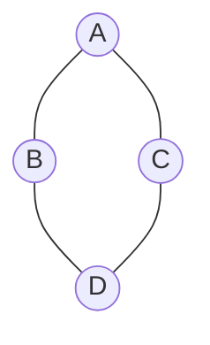
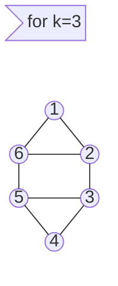
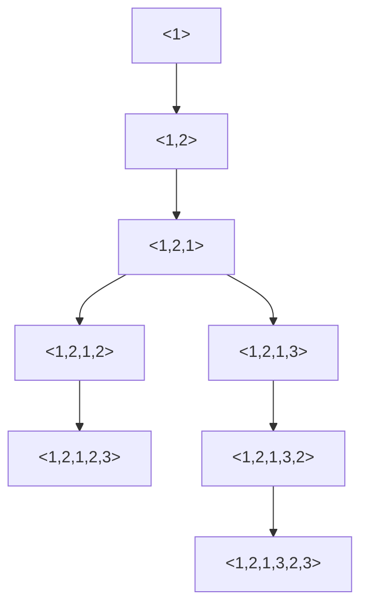

# Graph coloring

Lets us assume we have a graph with V vertices

$G(V,E)$

$V = \{1,\dots,n\}$

$E \subseteq V\times V$

$G.suc(u) = \{v\in V | (u,v) \in E \}$
(G.suc(u) is the succesors of u in the graph)


$(u,v) \in E \iff (v,u) \ in E$

for the coloring there cant be two adjaccent vertices cant have the same color. we are looking for its $\underbrace{k}_\mathbb N \text{-coloring}$

colors: $1, 2, \dots$

## 1. Solutions
$$C = \langle c_1, \dots, \underset{\substack{\uparrow\\{\text{color of the i-th vertex}}}}{c_i}, \dots, c_r \rangle$$

$$\forall i \in \{1\dots n\} \colon \forall j \in G.suc(i) \colon c_i \not = c_j$$

$$\forall i \in \{1\dots n\}: c_i \in \{i,\dots,k\}$$


we could assign the coloring $<1,2,1,2>$ or $<2,1,2,1>$

## 2. Symmetries
Any solution obtained from renaming the colors of a given solution is equivalent to the latter.

Given $c$ and $c'$ they are equivalent if 

$$\forall i, j \in \{1\dots n\}\colon (c_i = c_j) \iff (c_i' = c_j')$$

### Symmetry breaking:

An idea for this would be to use the first color for the second vertex, and then for the remaining vertices we could try to re-use any of the colors from before, and if we can't use any we would use a new one.

$$\forall i \in \{1,\dots,n\}: 1\le c_i \le \underset{1\le j \lt i}{\max} c_j +1$$

## 3. Decisions

Which color is assigned to vertex i-th vertex?

## 4. Elements of the algorithm

### Initial state

$S = \langle 1 \rangle$

### Partial state

$S = \langle s_1, \dots, s_i \rangle$
$m\le n$
$\forall i \in \{1\dots m\}\colon s_i\in \{1\dots k\}$
$\forall j \in G.suc(i)\colon s_j \not = s_i$
$1 \le s_i \le \underset{1\le j < i}{\max} c_j+1$

### Final state

Partial solution with $m = n$

### Branching
Our current state goes up to $S_m$
$$\langle s_1, \dots, s_m\rangle 
\begin{cases}
.\\.\\
\langle s_1, \dots, s_m, s_{m+1}\rangle\\
.\\.
\end{cases}$$

#### For all the $S_{m+1}$:
$1 \le S_{m+1} \le \min(k, \underset{i \le j \le m}{\max} c_j +1)$

$\forall i \in \{1\dots m\} \colon m+1 \in G.suc(i) \Rightarrow s_i \not = s_{m+1}$

## Algorithm


que aproveche!!

```pascal
proc GraphColoring(\downarrow G: Graph, \downarrow \uparrow sol: List<N>, \downarrow K: N, \uparrow OK: B)
variables:
    m, c, maxColor : N

begin:
    m <- sol.length()
    if m <- G.numVertices() then OK <- true
    else
        OK <- false
        maxColor <- min(K, max(Sol)+1)
        c <- 1
        while c \le maxColor \land ¬OK do
            if feasible(G, sol, c) then
                Sol.add(c)
                GraphColoring(G, sol, K, OK)
                if ¬OK then
                    sol.removelast()
                endif
            endif
            c <- c+1
        endwhile
    endif
end

func feasible(\downarrow G: Graph, \downarrow sol: List<N>, \downarrow c: N) : B
variables

begin:
    m <- sol.length()
    for i <- 1 to m do
        if(m+1 \in G.suc(i)) \land sol.get(i) = c) then
            return false
        endif
    endfor
    return true
end
```






```pascal
func ChromaticNumber(\downarrow G: Graph): List<N>
variable
    OK: B
    K: N
    sol: List<N>
begin
    for k <- 1 to G.numVertices() do
        sol <- <1>
        GraphColoring(G, sol, K, OK)
        if OK then return sol endif
    endfor
end
```

Modifying the previous function to directly obtain the chromatic number would be:

```pascal
proc GraphColoring(\downarrow G: Graph, \downarrow \uparrow sol: List<N>, \downarrow K: N, \uparrow OK: B)
variables:
    m, c, maxColor : N

begin:
    m <- sol.length()
    if m = G.numVertices() then 
        best <- sol
    else
        OK <- false
        maxColor <- min(max(Sol)+1, max(best)-1)
        c <- 1
        while c \le maxColor do
            if feasible(G, sol, c) then
                Sol.add(c)
                GraphColoring(G, sol, K, OK)
                if ¬OK then
                    sol.removelast()
                endif
            endif
            c <- c+1
        endwhile
    endif
end

func feasible(\downarrow G: Graph, \downarrow sol: List<N>, \downarrow c: N) : B
variables

begin:
    m <- sol.length()
    for i <- 1 to m do
        if(m+1 \in G.suc(i)) \land sol.get(i) = c) then
            return false
        endif
    endfor
    return true
end
```